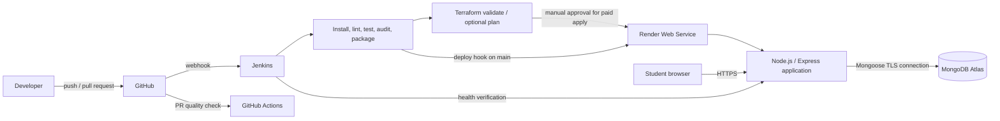

# CampusFlow Student Registry

CampusFlow is a complete DevOps demonstration project. It collects student details in a responsive web form, stores validated records in MongoDB, displays a success popup, and lists recent registrations. The delivery path is GitHub → Jenkins → Terraform/Render → MongoDB Atlas.

## Live deployment

- Application: https://campusflow-student-registry.onrender.com
- Health check: https://campusflow-student-registry.onrender.com/api/health
- Source: https://github.com/shakthish-17/dev-ops
- Hosting: Render free web service managed by the `campusflow` Blueprint
- Database: MongoDB Atlas free `CampusFlow` cluster

## What the project demonstrates

- Responsive HTML, CSS and JavaScript frontend with an accessible success dialog
- Node.js 24 and Express 5 REST API
- MongoDB persistence through Mongoose, including unique student IDs
- Server-side validation, rate limiting, security headers and bounded request bodies
- Automated linting, API tests, dependency audit and package creation
- GitHub pull-request validation
- Jenkins declarative CI/CD with quality gates and manual infrastructure approval
- Render deployment by Blueprint (free classroom path) or Terraform (managed paid path)
- Docker image definition and health checks
- Infrastructure as code with pinned providers and remote-state configuration

## Application behavior

The registration form accepts student ID, name, email, optional phone number, department, course and current year. On submission, the browser sends `POST /api/students`. The API validates and normalizes the payload, rejects duplicate student IDs, and writes the record to MongoDB. The frontend then opens a confirmation popup and refreshes the recent-students table.

## Architecture



### Request flow

```text
Browser form
  → POST /api/students
  → Zod validation and normalization
  → repository interface
  → Mongoose model
  → MongoDB students collection
  → HTTP 201 response
  → success popup + refreshed table
```

For local development only, the application automatically uses an in-memory repository when `MONGODB_URI` is absent. Production refuses to start without MongoDB, preventing accidental non-persistent deployments.

## Repository layout

```text
.
├── .github/workflows/ci.yml       GitHub pull-request validation
├── .vscode/                       Recommended extensions, tasks and settings
├── docs/                          Architecture, deployment and rubric evidence
├── public/                        Browser UI
├── src/                           API, service, model and repositories
├── terraform/                     Render infrastructure as code
├── test/                          Node API tests
├── Dockerfile                     Reproducible production container
├── Jenkinsfile                    Main CI/CD pipeline
├── render.yaml                    Render free-plan Blueprint
└── package.json                   Runtime and quality commands
```

## Prerequisites

- Node.js 24 LTS and npm
- Git
- Terraform 1.6 or newer for infrastructure work
- MongoDB Atlas connection string for persistent deployment
- Jenkins with NodeJS, GitHub and Credentials plugins
- Render account connected to the GitHub repository

## Run locally

From the VS Code terminal:

```powershell
npm.cmd install; npm.cmd start
```

Open `http://localhost:3000`. With no MongoDB environment variable, local data is held in memory and is cleared when the process stops.

To test against MongoDB, copy `.env.example` values into your terminal environment or secret manager. Do not commit a real connection string.

## Quality commands

```powershell
npm.cmd run lint
npm.cmd test
npm.cmd audit --omit=dev --audit-level=high
.\.tools\terraform\1.17.0\terraform.exe -chdir=terraform init -backend=false
.\.tools\terraform\1.17.0\terraform.exe -chdir=terraform validate
```

`npm test` covers the frontend route, health endpoint, input validation, record creation/listing and duplicate protection.

## API

| Method | Route | Purpose | Success |
|---|---|---|---|
| `GET` | `/api/health` | Readiness and database-mode check | `200` |
| `GET` | `/api/students` | List up to 50 recent records | `200` |
| `POST` | `/api/students` | Validate and create a student | `201` |

Example request:

```json
{
  "studentId": "STU-2026-001",
  "fullName": "Aarav Sharma",
  "email": "aarav@example.edu",
  "phone": "+91 98765 43210",
  "department": "Computer Science",
  "course": "B.Tech Computer Science",
  "year": 3
}
```

## CI/CD flow

1. A developer pushes code to GitHub or opens a pull request.
2. GitHub Actions runs lint, tests, production dependency audit and Terraform validation.
3. GitHub notifies the Jenkins multibranch job through a webhook.
4. Jenkins checks out the exact commit, installs locked dependencies with `npm ci`, then runs lint, tests and the security audit.
5. Jenkins packages the application and archives the artifact plus test report.
6. Terraform formatting and validation always run.
7. Terraform plan runs only when `TERRAFORM_PLAN` or `TERRAFORM_APPLY` is selected.
8. Terraform apply requires explicit Jenkins approval because the provider-managed Render service uses a billable plan.
9. On a successful `main` build, Jenkins calls the Render deploy hook for the exact Git commit.
10. Jenkins polls `/api/health`; the pipeline fails if the live service does not become healthy.

This ordering prevents a failed lint, test, audit or infrastructure validation stage from reaching deployment.

## Deployment choices

### Option A: Render Blueprint (recommended classroom/free path)

1. Push this repository to GitHub.
2. Create a Render Blueprint from the repository.
3. Render reads `render.yaml` and creates a free Docker web service.
4. Enter `MONGODB_URI` as a secret when Render requests it.
5. After the first successful deployment, create a deploy hook and save it in Jenkins.

### Option B: Terraform-managed Render service

Terraform uses `render-oss/render` version `1.9.1`. The provider requires `RENDER_API_KEY` and `RENDER_OWNER_ID`; `TF_VAR_mongodb_uri` supplies the database secret. The default `starter` plan is billable, so review `terraform plan` and approve the Jenkins gate before apply.

See [Deployment runbook](docs/DEPLOYMENT.md) and [Terraform guide](terraform/README.md).

## Required Jenkins credentials

| Credential ID | Jenkins type | Purpose |
|---|---|---|
| `render-api-key` | Secret text | Terraform provider authentication |
| `render-owner-id` | Secret text | Render workspace/owner |
| `mongodb-uri` | Secret text | MongoDB Atlas connection string |
| `terraform-backend-config` | Secret file | Remote-state backend settings |
| `render-deploy-hook-url` | Secret text | Deploy the verified commit |
| `render-app-url` | Secret text | Post-deployment health check base URL |

Jenkins also needs a configured NodeJS tool named `node24` and Terraform available on the agent `PATH`.

## Environment variables

| Variable | Required | Description |
|---|---|---|
| `PORT` | Render supplies it | HTTP port; defaults to `3000` locally |
| `NODE_ENV` | Yes in production | Use `production` on Render |
| `MONGODB_URI` | Yes in production | MongoDB connection string; secret |
| `MONGODB_DATABASE` | No | Defaults to `student_registry` |
| `USE_IN_MEMORY_DB` | Local/test only | Set `true` to force temporary storage |

## Security controls

- Secrets are excluded from Git and injected through Render/Jenkins.
- Helmet sets browser security headers and a restrictive content security policy.
- API requests are rate limited and JSON bodies are capped at 32 KB.
- Zod validates all submitted data on the server.
- MongoDB enforces a unique student ID index.
- The production container runs as the unprivileged `node` user.
- Dependency and infrastructure validation happen before deployment.
- Terraform apply and billable infrastructure have a manual approval gate.

## Project status

| Area | Status |
|---|---|
| Frontend and success popup | Implemented |
| REST API and validation | Implemented |
| MongoDB model and repository | Implemented |
| Automated tests and lint | Passing locally |
| Production dependency audit | 0 known vulnerabilities at last validation |
| Docker and Render Blueprint | Implemented |
| Terraform initialization/validation | Passing locally |
| Jenkins pipeline | Implemented; requires Jenkins configuration |
| GitHub repository push | Published to `shakthish-17/dev-ops` |
| MongoDB Atlas persistence | Live on the free `CampusFlow` cluster |
| Public Render deployment | Live and health-checked |

The application is live on Render and persists records in MongoDB Atlas. Jenkins execution still requires a separately hosted Jenkins controller and the documented credentials. Secrets remain outside the repository.

## Documentation

- [Architecture and data flow](docs/ARCHITECTURE.md)
- [Deployment runbook](docs/DEPLOYMENT.md)
- [Jenkins setup](docs/JENKINS.md)
- [DevOps rubric evidence](docs/RUBRIC.md)
- [Verification record](docs/TEST_RESULTS.md)

## License

Created as an educational DevOps project. Add an institution-approved license before public reuse.
