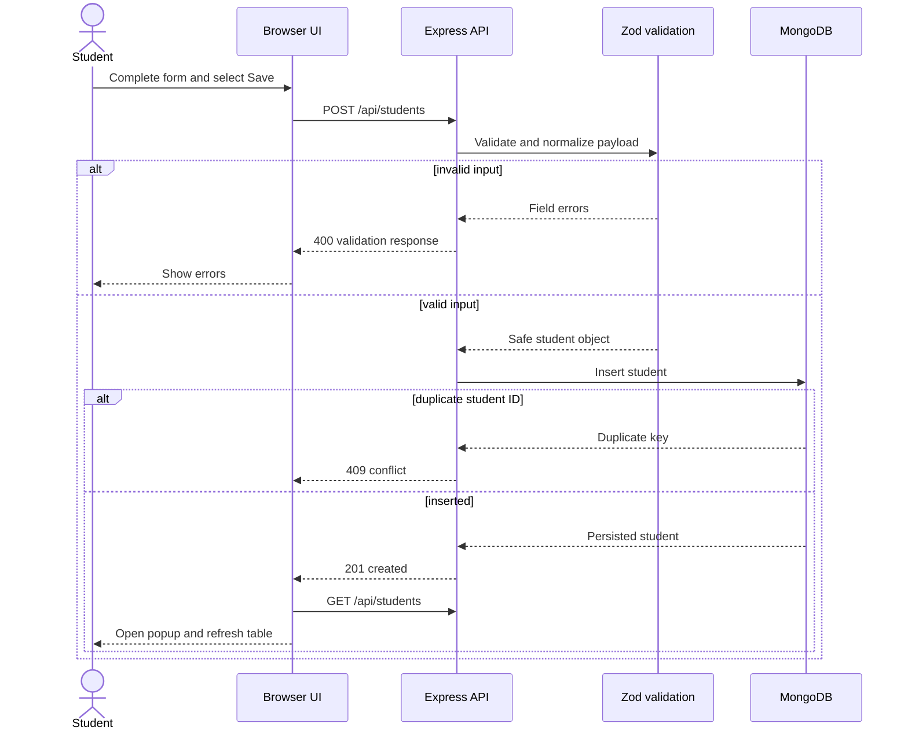

# Architecture and Data Flow

## Components

| Component | Responsibility |
|---|---|
| Browser UI | Captures details, reports validation errors, displays the success dialog and recent records |
| Express API | Security middleware, routing, validation and error responses |
| Student service | Normalizes and validates the business payload |
| Repository boundary | Keeps persistence separate from HTTP behavior |
| Mongo repository | Persists records with Mongoose in the `students` collection |
| Memory repository | Enables deterministic local development and automated tests |
| MongoDB Atlas | Production database with TLS connectivity and credentials |
| GitHub | Source control, pull requests and webhook source |
| Jenkins | Main CI/CD orchestrator and deployment gatekeeper |
| Terraform | Declarative Render service configuration |
| Render | Builds, runs, exposes and health-checks the web service |

## Runtime sequence

## Failure boundaries

- Invalid form data is rejected before database access.
- Duplicate student IDs return `409` without overwriting a record.
- MongoDB connection failure prevents a production server from becoming ready.
- Any CI quality failure stops later deployment stages.
- Terraform apply is opt-in and manually approved.
- Live health failure marks the Jenkins build failed.
